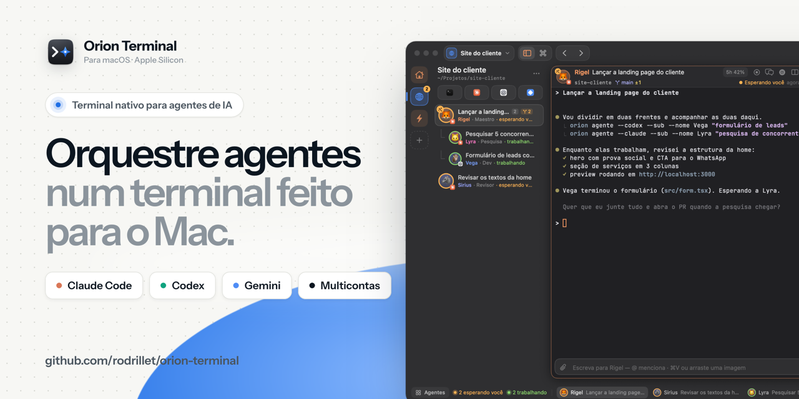

<p align="center"></p>

# Orion Terminal

**Terminal nativo para macOS feito para orquestrar agentes de IA.** Claude Code, Codex e Gemini CLI
rodam lado a lado, cada um com a sua conta, organizados em workspaces — um por projeto ou cliente.
Um agente "maestro" pode criar subagentes, acompanhar o trabalho deles e receber o resultado de volta.
Tudo em AppKit + SwiftUI + [SwiftTerm](https://github.com/migueldeicaza/SwiftTerm): leve (CPU parada
em 0% e ~40–90 MB de memória), com vidro de verdade, temas claros e escuros e um CLI (`orion`) para
que os próprios agentes operem o terminal.

## Instalar

```bash
curl -fsSL https://raw.githubusercontent.com/rodrillet/orion-terminal/main/install.sh | bash
```

O instalador baixa o último [release](https://github.com/rodrillet/orion-terminal/releases), confere
o SHA-256, coloca o app em **Aplicativos**, libera a abertura no macOS e instala o comando `orion` em
`~/.local/bin`. Não pede senha. Rodar de novo atualiza.

**Requisitos:** Mac com Apple Silicon (M1 ou mais novo) e macOS 15 (Sequoia) ou mais novo. Para os
agentes, tenha instalado o que for usar: [Claude Code](https://docs.anthropic.com/en/docs/claude-code),
[Codex CLI](https://github.com/openai/codex) e/ou [Gemini CLI](https://github.com/google-gemini/gemini-cli).

<details>
<summary>Instalar sem o terminal</summary>

1. Baixe `Orion-Terminal-<versão>.zip` no [último release](https://github.com/rodrillet/orion-terminal/releases/latest) e abra o zip.
2. Arraste o **Orion Terminal** para Aplicativos.
3. Na primeira vez o macOS avisa que não pôde verificar o desenvolvedor (o app não é da App Store nem
   assinado com certificado pago). Abra **Ajustes do Sistema → Privacidade e Segurança** e clique em
   **Abrir Mesmo Assim** ao lado de "Orion Terminal". Alternativa: `xattr -dr com.apple.quarantine "/Applications/Orion Terminal.app"`.
</details>

## Atualizações automáticas

Assim que uma versão nova é publicada aqui, todos os apps instalados percebem e se atualizam:

- o app consulta o release mais novo ao abrir, ao voltar para a frente (no máximo a cada 20 min) e a
  cada hora — com ETag, então uma consulta sem novidade não gasta o limite da API do GitHub;
- versão nova é **baixada em segundo plano**, conferida pelo SHA-256 publicado no release e pelo
  identificador e número de versão do pacote;
- aparece um aviso (notificação + botão no topo) e ela **entra sozinha quando você fecha o app** —
  ou na hora, com *Reiniciar e atualizar*. A troca do pacote volta atrás se algo falhar.

Em **Ajustes → Sobre e atualizações** dá para escolher *Automáticas*, *Só avisar* ou *Desligadas*.
Pelo terminal: `orion versao` e `orion atualizar`.

## Privacidade

O Orion Terminal não tem conta, servidor nem telemetria. As únicas conexões que ele faz são:

| Para onde | Quando | Por quê |
|---|---|---|
| `api.github.com` / `github.com` | ao verificar e baixar atualizações | ler o release mais novo (público, sem login) |
| `api.anthropic.com/api/oauth/usage` | só se você ligar "Uso do Claude" | mostrar o uso de 5 h e 7 dias da sua conta; o login é lido do Chaveiro do seu Mac e nunca sai dele para outro lugar |

O uso do Codex é lido dos arquivos locais das sessões dele. Contas ficam em
`~/Library/Application Support/Orion Terminal/perfis` (uma pasta por conta, via `CLAUDE_CONFIG_DIR`,
`CODEX_HOME` e `GEMINI_CLI_HOME`).

## O que tem

| Parte | Como funciona |
|---|---|
| **Agentes como personagens** | Os mascotes são **vivos**: piscam (cada um no seu tempo), olham em volta, respiram, sorriem de vez em quando; trabalhando, olham mais rápido e o halo pulsa; esperando você, olham para cima; dormindo/hibernando, "zz". A animação é de camadas do Core Animation (desenho feito uma vez, movimento no servidor de janelas): **0% de CPU no app**, congela com o app em segundo plano e some com "Reduzir movimento". Desliga em Ajustes → Aparência → Mascotes animados. Tamanho dos mascotes em Ajustes → Aparência (pequeno, médio, grande). Cada agente tem nome, mascote, cor e papel (Rigel, Vega, Lyra…), além da ferramenta (Claude Code, Codex ou Gemini CLI) e da conta. O mascote é desenhado em vetor — oito formas (gota, bolha, nuvem, pílula, hexágono, flor, fantasma, losango) — com olhos e boca que mudam com o estado: olhar de lado e halo trabalhando, olhos arregalados e boca em "o" esperando você, fechados dormindo. O **papel veste o mascote**: coroa no maestro, óculos no revisor/testes, antena no dev/infra/dados, fones no conteúdo, lupa na pesquisa, boina no design. Ele pisca quando o mouse passa e dá um pulinho quando começa a esperar você — só por evento, nunca em loop, e nada se mexe com "Reduzir movimento" ligado. Duplo clique no avatar (ou menu → Personagem…) edita. No compose e no CLI ele é chamado pelo nome: `@rigel`; `--nome Lyra` (um nome do elenco) já vem com a forma e a cor dela. |
| **Nome que diz o que ele faz** | O título do agente é a tarefa: a primeira mensagem (do compose, do diálogo ou de `--mensagem`) resumida, e depois o título que a própria ferramenta manda. “Nome · papel · conta” fica na linha de baixo. Renomear: ⇧⌘R ou duplo clique no título, no quadro. |
| **Maestro e subagentes** | Um agente cria outros (`orion agente --pai $ORION_PAINEL …`, ou menu → Novo subagente…). Os filhos aparecem recuados sob o maestro na barra lateral e dentro do cartão dele no quadro. O maestro acompanha com `orion filhos`, espera com `orion esperar --filhos` e lê a resposta com `orion resultado ID`; com `--retorno`, o resultado volta sozinho para a conversa dele. |
| **Caixa de entrada** | As respostas a quem pediu para vários colegas voltam **juntas**, numa entrega só, quando todos responderem (ou em 15 min); confirmações curtas ("ok", "valeu") ficam registradas mas não acordam ninguém; a mesma mensagem para o mesmo colega em menos de 1 h não duplica; destinatário que fechou ou saiu do agente cancela a mensagem e avisa quem mandou; nada é colado no shell de um agente que saiu. O aviso "subagente terminou" vai pela fila (nunca por cima de uma pergunta do maestro) e não dispara quando ele só parou para pedir permissão. |
| **Caixa de entrada (como funciona)** | Agentes conversam sem atropelar uns aos outros: `orion mandar @vega "…"` põe a mensagem na fila dela e devolve um id na hora; ela só entra no terminal quando a Vega estiver livre (várias acumuladas viram uma entrega só). Quem mandou encerra o turno — a resposta (`orion responder ID "…"`) volta sozinha; se ela parar sem responder, chega um aviso com a última resposta. Ícone de bandeja no trilho (fila, entregues, respondidas; cancelar ou entregar já) e selo ✉ no agente com mensagem esperando. Mensagem do compose (⌥↩) para um agente ocupado também vai para a fila. |
| **Hibernar agentes parados** | Cada Claude ocupa de ~85 MB (recém-aberto) a ~500 MB (sessão longa). Agente parado esperando você, fora da aba ativa, sem servidor nem comando rodando e sem nada na fila, hiberna depois do tempo escolhido em Ajustes → Agentes → Memória (padrão 30 min; 0 = nunca): o processo fecha e a conversa volta exatamente no ponto (`claude --resume <id>`, `codex resume <id>`) quando você abre a aba ou chega mensagem para ele — a mensagem espera o agente subir antes de entrar. Com o Mac apertado (menos de 1,5 GB livres), hiberna antes da hora quem está parado há mais de 5 min, do mais antigo para o mais novo, e avisa embaixo da janela. Menu da aba → Hibernar agora; `orion hibernar ID`, `orion acordar ID`. O Gemini CLI não retoma por id e não hiberna. |
| **Perguntar ao time** | `orion mandar @time "…"` (ou "@time …" no compose, ou menu do workspace/setor → Perguntar ao time): o Orion escolhe quem responde pelo nome citado, pelo papel, pela tarefa e por quem está livre. Quem não tem o que acrescentar passa a vez com `orion passar ID "motivo"` e a mensagem vai para o próximo. |
| **Pull request → Revisar** | Quando o link de um PR recém-aberto aparece na tela do agente, o cartão vai sozinho para Revisar no quadro, com um selo "#N" que abre o PR. |
| **Parar com motivo** | Clique direito no Parar, menu da aba, paleta ou `orion interromper ID --motivo "…"`: o agente para e lê o motivo antes de seguir. |
| **Setores** | Grupos de agentes dentro do workspace (Site, Tráfego, Conteúdo…): na barra lateral cada setor tem título com contagem, recolhe com um clique (recolhido continua mostrando quem trabalha ou espera você) e aceita agentes arrastados para o título. Menu da aba → Setor; `orion setor ID "Nome"`, `orion agente --setor "Nome"`. Subagentes nascem no setor do maestro; o setor aparece no cartão do quadro e em `orion equipe`. |
| **Quem espera você** | No alto da barra lateral, um aviso diz quantos agentes do workspace esperam você e quantos pedem permissão; clique (ou **⌘J**, de qualquer lugar) vai para o próximo — primeiro quem pede permissão, depois quem espera há mais tempo, em todos os workspaces; repetir percorre a fila. Nas linhas, o estado vira chip com ícone: permissão, esperando, trabalhando. `orion ui proximo`. |
| **Paleta** (⌘P) | Além de ações, workspaces, abas, contas, temas e pastas, entende **pedidos**: escreva o que quer e escolha "Pedir a Lyra: “…”" (ocupado, vai para a fila), ou `@lyra texto` para ir direto. |
| **Equipe** | Cada personagem tem uma descrição (o que faz, quando mandar trabalho para ele); `orion equipe` lista os colegas do workspace com papel, descrição e estado. `orion interromper` vindo de um agente só vale para subagentes dele ou quem tem um pedido dele em andamento (`--forcar` passa por cima). |
| **Workspaces** | Seletor no topo (dropdown com a pasta, as abas e quantos agentes trabalham ou esperam em cada um); ⌃1…⌃9 troca (a tela desliza), ⌃⌘↑/↓ anterior e seguinte, ⇧⌘G cria. |
| **Barra lateral** | Trilho de ícones à esquerda (agentes, quadro, histórico, portas, notificações, ajustes) e, ao lado, a busca e as seções Agentes, Terminais e Histórico: cada agente com mascote, nome, papel, hora e o que está fazendo — ou a última coisa que disse. O histórico lista os agentes fechados por dia; um clique reabre na mesma conversa. Clicar no título de uma seção recolhe/abre; o histórico tem menu de contexto (reabrir, copiar o comando de retomar, tirar da lista), botão de apagar no hover e "Limpar tudo" com confirmação. |
| **Compose** (⌘E) | Caixa de escrita embaixo do painel. Em repouso é uma linha só; com foco, texto ou o mouse em cima ganha a barra de ferramentas: clipe, **@**, **/** (os comandos da ferramenta — `/clear`, `/compact`, `/model`… — com o que cada um faz), a etiqueta "Para Lyra" com o mascote de quem recebe e o botão que cresce para **Enviar ↩** quando há texto. ↩ envia, ⇧↩ quebra a linha, ↑ ↓ histórico, esc volta ao terminal. **@** menciona outro terminal/agente (↩ anexa o contexto dele; ⌥↩ manda a mensagem para ele), pastas e arquivos — a menção vira uma **etiqueta** dentro do texto. **Imagens e arquivos**: ⌘V (também com o terminal em foco), arrastar para qualquer lugar do painel, ou o clipe — viram cartões com miniatura (Quick Look) e prévia grande ao clicar; arquivos entram na mensagem como `@caminho`. Com o agente trabalhando e a caixa vazia, o botão vira **Parar**. |
| **Pedido de permissão** | Quando o agente para perguntando "Do you want to proceed?" com opções numeradas, o Orion lê a pergunta e o comando da tela e mostra as opções como botões — no chat e acima do compose, num cartão neutro com o chip âmbar "Lyra pede permissão" (a pergunta sai do texto do chat, para não aparecer duas vezes). A barra lateral mostra o chip "permissão", a notificação diz o que ele quer fazer, e a caixa de entrada nunca cola mensagem por cima da pergunta. `orion agentes --json` traz o pedido em `permissao`. |
| **Vista de conversa** (⌥⌘C) | Layout de chat de equipe: avatar e nome na primeira mensagem de um grupo (você é "Você", num círculo; agentes são o mascote), texto na largura da coluna sem balão, mensagens seguidas do mesmo autor agrupadas e ações (copiar, citar, escrever de novo) numa barrinha que aparece ao passar o mouse. As ferramentas vêm por último, recolhidas em "N passos" com um check por passo — também na leitura da tela, onde `Read(arquivo)` + `⎿ …` viram passos. No Claude Code e no Codex, o chat é lido do arquivo da própria sessão (Markdown original, blocos de código com "Copiar"); Gemini CLI e terminais comuns usam a leitura da tela. Estado em chip com ícone (trabalhando, esperando você, pede permissão), separador por dia, copiar a conversa inteira em Markdown e limpar a conversa (o terminal não muda). Só existe com a vista aberta e só relê o terminal quando chega saída. |
| **Quadro de agentes** (⇧⌘A) | Cinco colunas: esperando você · trabalhando · revisar · parados · concluído. Cartões com o personagem; o maestro mostra os subagentes dentro dele. Filtros por workspace, ferramenta e texto. Vira lista em janela estreita. |
| **Fechados há pouco** (⌥⌘Z) | Fechou um agente sem querer? O relógio na barra do topo lista os últimos 20; um clique reabre na mesma pasta, conta e personagem, retomando a conversa (`claude --resume <id>` / `codex resume <id>` quando o id é encontrado; senão a última daquela pasta). Ao sair do app, o id de cada conversa é anotado para voltar exatamente nela. |
| **Portas em uso** (⌥⌘P) | Os servidores que os painéis subiram (node, vite, next, python…): a porta aparece no cabeçalho do painel (clique abre no navegador) e na barra de baixo; a lista abre no navegador, leva ao painel e **libera a porta** (encerra o processo, com confirmação). `orion portas`, `orion liberar 3000`. |
| **Botões do Claude / Codex / Gemini** | Hover = resumo; clique = painel (contas, uso, agentes, “Novo …”); ⌥-clique ou duplo clique abre direto. O seletor de conta do painel é um popover com cor, e-mail e barras de uso. |
| **Gemini CLI** | Terceira ferramenta, com multiconta: cada conta é uma pasta apontada por `GEMINI_CLI_HOME` (a configuração fica em `<pasta>/.gemini`). O Gemini CLI não informa uso; o resto é igual. Dá para esconder qualquer ferramenta em Ajustes → Janela. |
| **Vidro de verdade** | A janela é transparente: em Ajustes → Aparência, “Transparência” diz quanto se vê do que está atrás e “Desfoque” vai de nítido a fosco. Sem `NSVisualEffectView`. |
| **Ajustes** | Linhas com ícone, nome e controle; prévia ao vivo na Aparência; busca que acha um ajuste em qualquer seção. A janela é descartada ao fechar. |
| **Menu de contexto / ⌘-clique** | Detecta caminho ou link sob o mouse: abrir, navegador, Finder, novo terminal, copiar, mencionar no compose. Submenu **Copiar…**: seleção como bloco de código ou numa linha, último comando e a saída, só a saída, última resposta do agente, tela visível, tudo, pasta atual. ⇧⌘C copia o último resultado; "Copiar ao selecionar" fica em Ajustes → Terminal. |
| **Texto nítido** | Os painéis ficam sempre em pixels inteiros e, ao redimensionar, a camada do terminal fica ancorada (nunca esticada) até redesenhar no tamanho novo; o programa só recebe o tamanho (SIGWINCH) quando o arrasto para. |
| **Leve** | Nada anima em loop (o ponto de estado é estático): CPU ociosa em 0%. O tique de 1 s só lê o nome do processo quando ele muda; memória a cada 10 s e portas a cada 12 s, só com a janela à vista. |
| **Sessões, temas, autocomplete, avisos** | Reabre workspaces e abas; 17 temas + editor (exporta/importa); modo claro, escuro ou automático; lista de sugestões embaixo do que você digita; notificações quando um agente para e espera você. |

## Atalhos

| | |
|---|---|
| Workspace 1–9 · seguinte / anterior · novo | ⌃1…⌃9 · ⌃⌘↓ / ⌃⌘↑ · ⇧⌘G |
| Quadro · próximo que espera você · interromper agente · atualizar uso | ⇧⌘A · ⌘J · ⌘. · ⌥⌘U |
| Novo terminal · Claude · Codex · Gemini | ⌘T · ⇧⌘T · ⇧⌘X · ⌥⌘G |
| Novo agente com opções · novo subagente · reabrir fechado | ⌥⌘N · ⇧⌥⌘N · ⌥⌘Z |
| Compose: escrever/voltar · mostrar/esconder · anexar | ⌘E · ⇧⌘E · ⌥⌘A |
| Conversa / terminal · portas em uso | ⌥⌘C · ⌥⌘P |
| Aba 1–9 · seguinte / anterior · voltar / avançar | ⌘1…⌘9 · ⇧⌘] / ⇧⌘[ · ⌥⌘[ / ⌥⌘] |
| Dividir · painel vizinho · maximizar | ⌘D / ⇧⌘D · ⌥⌘setas · ⇧⌘↩ |
| Paleta · barra lateral · barra de agentes · ajustes | ⌘P · ⌘B · ⇧⌘B · ⌘, |

## Para agentes de IA: o comando `orion`

Cada painel exporta `ORION_PAINEL` (o próprio id) e `ORION_SOCKET`. O app escuta em
`~/Library/Application Support/Orion Terminal/controle.sock` (só o seu usuário).

```
# Caixa de entrada (quem manda não espera: a resposta chega sozinha)
orion equipe [--workspace W] [--tudo]        quem é quem: personagem, papel, descrição, estado
orion mandar ID|@nome "texto" [--anexo ARQ]… [--sem-resposta]
orion mandar @time "texto" [--setor S]        o Orion escolhe quem do time recebe
orion passar ID_MSG ["motivo"]               não é com você: vai para o próximo do time
orion responder ID_MSG "Status: … | Resultado: … | Evidência: …"
orion caixa [ID] [--tudo] · orion cancelar ID_MSG

# Maestro e subagentes
orion agente --claude|--codex|--gemini --pai $ORION_PAINEL [--papel P] [--nome N] [--retorno]
             --mensagem "tarefa"             cria um subagente (em segundo plano) e devolve o id
orion filhos [ID] [--json]                   subagentes de um maestro: personagem, estado, tarefa
orion esperar --filhos [ID] [--tempo S]      espera todos pararem  (orion esperar ID = um só)
orion resultado ID [--linhas N]              a última resposta do agente, em bloco <contexto-orion>

# Agentes
orion agentes [--json] [--workspace W]       personagem, papel, pai, estado, tarefa, conta, memória
orion agente --claude|--codex|--gemini [--workspace W] [--pasta P] [--conta ID] [--nome N]
             [--papel P] [--mensagem "tarefa"] [--fundo]
orion enviar ID "texto" [--enter] [--anexo ARQ]… [--mencionar ID]…
orion compor ID ["texto"] [--anexo ARQ]… [--mencionar ID]… [--para ID]… [--focar] [--limpar]
orion contexto [ID] · orion ler [ID] [--linhas N] · orion interromper ID [--motivo "…"] · orion reiniciar ID · orion hibernar ID · orion acordar ID · orion setor [ID] "Nome"
orion marcar [ID] revisar|concluido|nada · orion personagem [ID] [--nome N] [--papel P] [--descricao "…"] [--avatar FORMA] [--maestro]
orion fechados · orion reabrir [N|ID] [--fundo]
orion conta ID CONTA · orion conta --padrao CONTA · orion contas · orion uso · orion memoria

# Workspaces, terminais e servidores
orion workspaces · orion workspace novo|focar|renomear|editar|fechar …
orion abas [--json] · orion nova --shell|--claude|… · orion dividir [ID] [--abaixo] [--comando C]
orion rodar "cmd" [--painel ID] --esperar    saída + código de saída
orion portas [--todas] [--json] · orion liberar PORTA
orion focar|fechar ID · orion notificar "texto"

# Interface
orion ui quadro|paleta|ajustes [seção]|contas|temas|lateral|barra|portas|proximo|fechar
orion ui claude|codex|gemini · orion ui uso [ferramenta] · orion ui conversa [ID]
orion ui compose [ID] | novo-agente [ferramenta] | subagente [ID] | personagem [ID] | novo-workspace
```

Ajustes → IA e CLI copia um bloco pronto para o CLAUDE.md / AGENTS.md, com as instruções do
maestro. `--grupo` (v0.2) ainda é aceito como sinônimo de `--workspace`.

## Compilar a partir do código

A licença permite compilar o código sem modificações para uso próprio. Só precisa das Command Line Tools (`xcode-select --install`); Xcode não é necessário.

```bash
git clone https://github.com/rodrillet/orion-terminal.git && cd orion-terminal
./build.sh             # build/Orion Terminal.app
./build.sh --instalar  # copia para /Applications e liga ~/.local/bin/orion
./build.sh --publico   # pacote de distribuição em dist/ (.zip + .zip.sha256)
```

**Publicar uma versão:** suba `VERSAO` no `build.sh`, escreva as novidades em `notas/<versão>.md`,
faça o commit e rode `./release.sh` — ele gera o pacote, cria a tag e o release no GitHub. Os apps
instalados se atualizam sozinhos.

**Sem Xcode:** `@State` virou macro no SDK novo e o plugin dela só vem com o Xcode; o código usa
`@Estado` (apelido para o property wrapper `SwiftUI.State`).

## Arquivos

| Arquivo | Papel |
|---|---|
| `Sources/OrionTerminal/Pty.swift` | `forkpty`, leitura em fila própria, processo em primeiro plano, pasta |
| `Shell.swift` | ambiente das abas e integração com o zsh (OSC 133 / 633 / 7) via `ZDOTDIR` |
| `Painel.swift` | terminal SwiftTerm + sessão; marcas OSC, captura da saída, estado do agente; `CaixaPainel` (o cartão: cabeçalho, terminal, compose, sombra) |
| `Compose.swift` | compose: rascunho, campo de texto (AppKit), menções `@`, anexos, contexto entre terminais, envio |
| `Contexto.swift` | detecção de caminho/link sob o mouse, ⌘-clique e o menu de contexto do terminal |
| `Dialogos.swift` | diálogos do app (confirmar, texto, workspace, agente, conta) — assíncronos |
| `Memoria.swift` | memória do app e da árvore de processos de cada painel |
| `MascoteVivo.swift` | mascote animado em camadas do Core Animation (piscar, olhar, respirar, halo, zz) |
| `Ferramentas.swift` | as três ferramentas (`Ferramenta`), personagens (`Persona`), nomes a partir da tarefa, descoberta do id da sessão, fechados |
| `Portas.swift` | portas em escuta (lsof), liberar porta, fechados há pouco e reabrir |
| `Conversa.swift` | vista de conversa (chat) e o avatar dos personagens |
| `SessaoChat.swift` | leitura incremental do arquivo de sessão do Claude/Codex para o chat, Markdown e ferramentas usadas |
| `Permissao.swift` | detecção do pedido de permissão na tela e o cartão com as opções |
| `Anexos.swift` | miniaturas e prévia de anexos (ImageIO, Quick Look, primeiras linhas de texto) |
| `Modelo.swift` | `Workspace`, `Aba`, árvore de divisões (`No`), `EstadoPainel`, `Conta`, `Uso` |
| `Loja.swift` | estado central: workspaces, abas, navegação, quadro, aparência, memória, persistência e migração |
| `LojaContas.swift` / `Contas.swift` | contas, login, cache de uso, cartão das ferramentas |
| `Temas.swift` | temas embutidos e do usuário (`temas.json`), cores (`Cor`), fontes (`F`) e raios (`R`) da interface |
| `Area.swift` | layout das divisões em AppKit (raízes guardadas por aba; nada é recriado ao trocar) |
| `Interface.swift` | janela, barra do topo, trilho, barra lateral, barra de agentes, memória, doca |
| `PainelUI.swift` / `Quadro.swift` / `UsoUI.swift` | cabeçalho do painel · quadro de agentes · botões do Claude/Codex (resumo e painel) |
| `Paleta.swift` / `AjustesView.swift` / `AparenciaView.swift` | paleta ⌘P · ajustes e guia para IA · aparência e editor de tema |
| `Sugestoes.swift` / `Specs.swift` | autocomplete |
| `Caixa.swift` | caixa de entrada: mensagens entre agentes, fila, entrega quando livre, respostas, aviso de "parou sem responder" (`caixa.json`) |
| `Controle.swift` + `Sources/orion` | socket e CLI para agentes |
| `Atualizador.swift` / `AtualizacaoUI.swift` | atualização pelos releases do GitHub (ETag, SHA-256, troca segura do pacote) e a seção Sobre |
| `tools/icone.swift` | desenha o ícone (placa grafite, prompt e a estrela da família Orion) |

Dados em `~/Library/Application Support/Orion Terminal/` (`ajustes.json`, `estado.json`, `contas.json`,
`uso.json`, `temas.json`, `compose.json`, `fechados.json`, `caixa.json`, `perfis/`).

## Testar sem atrapalhar a cópia instalada

```
ORION_DADOS=/tmp/orion-dev ORION_SEM_FOCO=1 ORION_USO_FALSO=1 "build/Orion Terminal.app/Contents/MacOS/OrionTerminal" &
ORION_SOCKET=/tmp/orion-dev/controle.sock "build/Orion Terminal.app/Contents/MacOS/orion" workspaces
```

`ORION_DADOS` troca a pasta de dados (estado, ajustes, socket — caminho curto, o socket Unix tem
limite de 103 caracteres). `ORION_SEM_FOCO=1` abre a janela atrás das outras, sem ícone no Dock e
sem roubar o foco. `ORION_USO_FALSO=1` nunca lê o Chaveiro nem a rede. Para capturas de tela sem
mouse nem teclado: `orion ui …` abre quadro, paleta, ajustes, o painel das ferramentas e os
diálogos, e `orion depurar …` injeta estados de teste: `uso`, `estado`, `agente`, `tamanho`,
`tema ID`, `ajuste CHAVE VALOR`, `dialogo confirmar|texto|workspace|agente|conta|ok|fechar`,
`mencao ID "@termo" [--aceitar]`, `colar ID --texto ARQUIVO` (área de transferência privada),
`soltar ID --texto ARQUIVO` (arrasto para o painel), `sessao ID` (id da conversa encontrado), `aliviar`,
`alvo ID --texto "linha" --coluna N`, `ponto ID --linha L --coluna C`, `menu ID --texto "linha"`
(lista os itens; com `--tempo S` também mostra o menu), `editar-tema`, `sistema claro|escuro`, `sair`.
O terminal só redesenha com a janela à vista: use `orion depurar frente` antes de capturar e
`orion depurar fundo` logo depois (a janela de teste na frente atrapalha quem está usando o Mac).

## Licença e direitos

**© 2026 Orya Growth. Todos os direitos reservados.** O código está aberto para leitura, não para
reuso: você pode baixar e usar o app de graça (inclusive no trabalho) e ler o código, mas **não pode
copiar, modificar, redistribuir, vender, nem usar o nome ou o ícone** sem autorização por escrito.
Texto completo em [LICENSE](LICENSE) (Lei nº 9.609/98 e Lei nº 9.610/98). Componentes de terceiros
mantêm as próprias licenças e estão em [THIRD_PARTY_NOTICES.md](THIRD_PARTY_NOTICES.md). Claude, Codex, ChatGPT e Gemini são marcas dos
respectivos donos; o Orion Terminal não é afiliado a eles e apenas abre as ferramentas de linha de
comando que você já tem instaladas.
