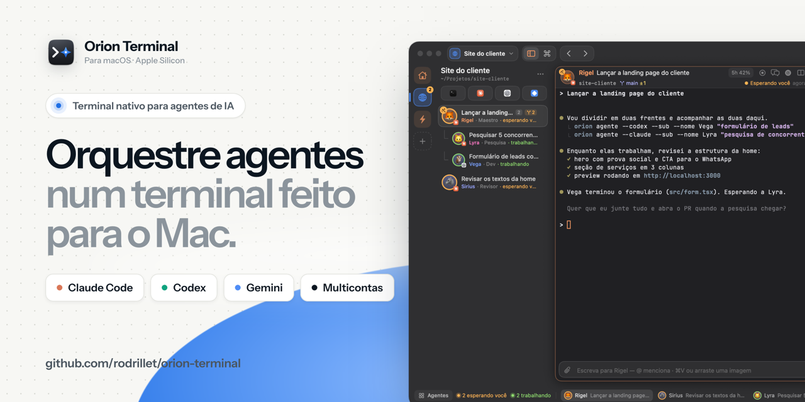

Primeira versão pública do Orion Terminal.

## Instalar

```bash
curl -fsSL https://raw.githubusercontent.com/rodrillet/orion-terminal/main/install.sh | bash
```

Requer Mac com Apple Silicon (M1 ou mais novo) e macOS 15 ou mais novo. Daqui em diante, as atualizações chegam pelo próprio app.

## O que tem

- Workspaces com terminais, divisões e agentes próprios; quadro de agentes em colunas (esperando você, trabalhando, revisar, parados, concluído).
- Claude Code, Codex e Gemini CLI em várias contas ao mesmo tempo, uma por aba; uso de 5 h e 7 dias no hover e troca de conta com um clique.
- Agentes como personagens, maestro com subagentes e sessões recuperáveis (⌥⌘Z reabre um agente fechado).
- Compose com @ para mencionar outro terminal, pasta ou arquivo e anexar imagem.
- Portas em uso, com liberar a porta em um clique.
- Temas claros e escuros, editor de tema, vidro transparente com desfoque ajustável.
- CLI `orion` para agentes de IA operarem o terminal (rodar comando e esperar o código de saída, abrir agentes, ler a tela).
- Atualização automática pelos releases do GitHub.
